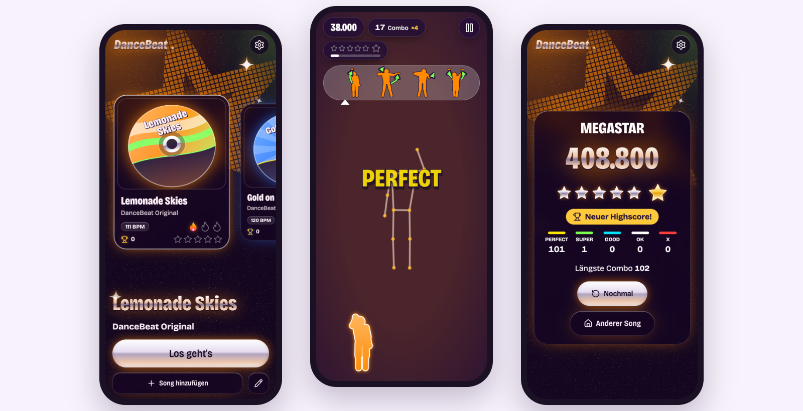
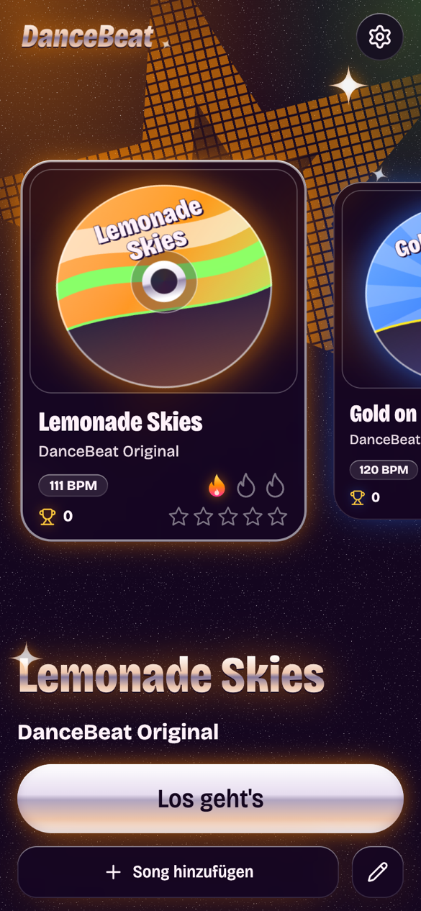
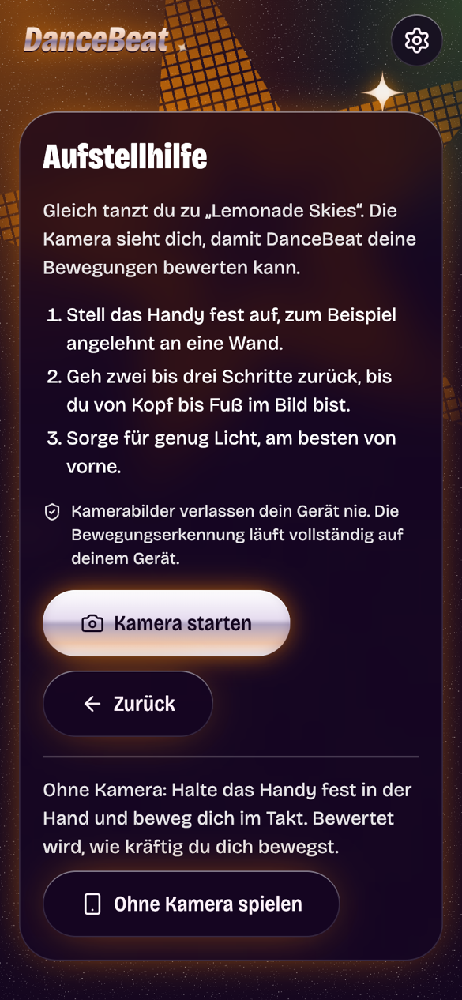
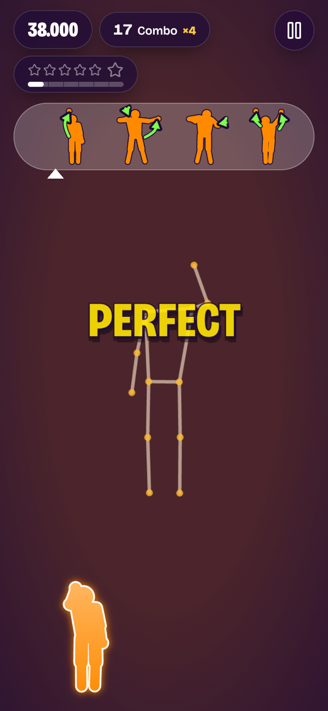
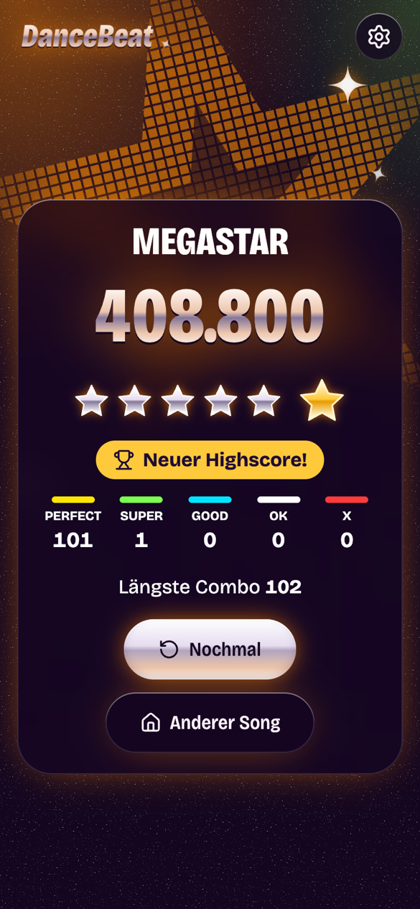
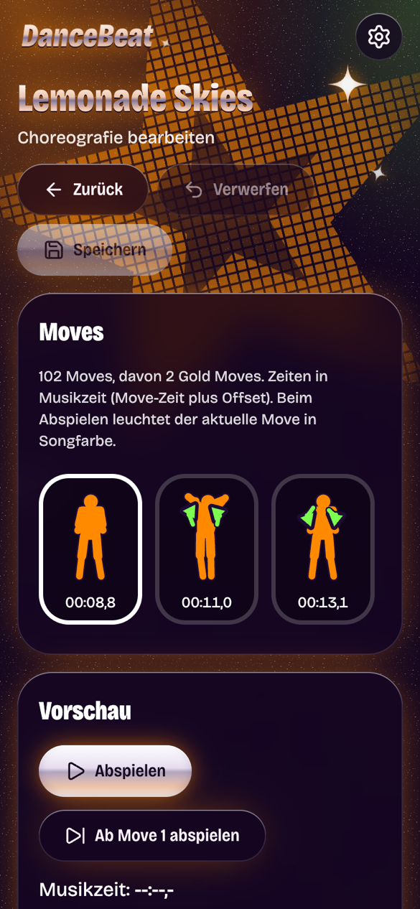
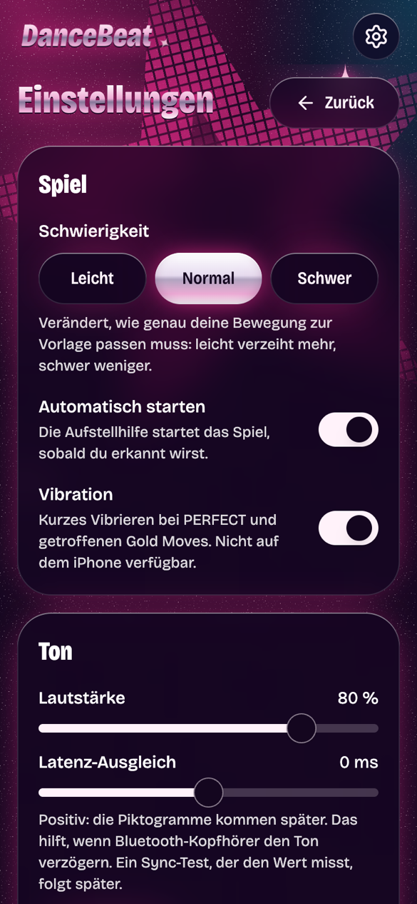
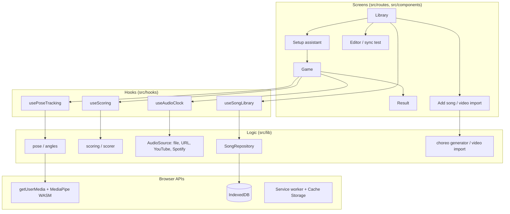

<div align="center">

# DanceBeat

A single-player dance game for your phone that scores your moves through the front camera, with
all pose detection running locally in the browser.

[](https://github.com/Simons-Github/dancebeat/actions/workflows/ci.yml)
[](https://react.dev)
[](https://www.typescriptlang.org)
[](https://vite.dev)
[](https://ai.google.dev/edge/mediapipe/solutions/vision/pose_landmarker)
[](#highlights)
[](LICENSE.md)

**[Live app](https://dancebeat.berger-labs.com)** · **[Repository](https://github.com/Simons-Github/dancebeat)**

<picture>
  <source media="(prefers-color-scheme: dark)" srcset="docs/screenshots/hero-dark.png">
  <source media="(prefers-color-scheme: light)" srcset="docs/screenshots/hero-light.png">
  
</picture>

</div>

## Contents

- [About](#about)
- [Screenshots](#screenshots)
- [Tech stack](#tech-stack)
- [Architecture](#architecture)
- [Run locally](#run-locally)
- [Database and storage](#database-and-storage)
- [CI](#ci)
- [Project structure](#project-structure)
- [Deployment](#deployment)
- [Limitations and privacy](#limitations-and-privacy)
- [License](#license)

## About

You prop the phone up, step back, and dance in front of the front camera. DanceBeat compares your
pose with the choreography in real time and rates every move. There is no backend, no account and
no multiplayer. The UI is in German.

### Highlights

| Area               | What the code does                                                                                                                                           |
| ------------------ | ------------------------------------------------------------------------------------------------------------------------------------------------------------ |
| Local pose scoring | MediaPipe Pose Landmarker (`lite`, GPU with CPU fallback) runs in the browser. Joint angles are compared in a ±250 ms window per move; ratings PERFECT to X. |
| Setup assistant    | Camera preview with target frame and skeleton, light check and full-body check; the game starts automatically once the whole body is detected.               |
| Gameplay           | Pictogram bar, coach figure, combo with multiplier, Gold Moves (5× points), pause, restart, star rating up to Megastar, result screen with highscore.        |
| Motion mode        | Play without the camera: the phone is held in the hand and the motion sensor measures movement intensity on the beat.                                        |
| Song sources       | Local audio file (BPM is estimated), HTTPS audio URL, YouTube (`youtube-nocookie.com`) or Spotify (Premium, own client ID).                                  |
| Choreography       | Generated from a bundled motion pack (AIST++ clips), imported from JSON, or built from a dance video analysed locally with MediaPipe.                        |
| Editor and sync    | Choreography editor (Gold Moves, delete moves, offset, tempo, preview) and a per-song tap sync test to compensate for audio latency.                         |
| Demo songs         | Four original demo songs with prebuilt choreographies are seeded into the library on first start.                                                            |
| PWA                | Installable, offline-capable via a custom service worker; screen wake lock during play and haptic feedback where supported.                                  |
| Privacy by design  | Camera frames never leave the device; a strict Content Security Policy blocks MediaPipe's built-in telemetry.                                                |

## Screenshots

Captured with headless Chrome at 390 × 844 from the dev server with the four bundled demo songs.
Gameplay and result come from the dev-only simulation mode, which replaces the camera with a
simulated player (the skeleton shows the simulated pose, not a camera image).

| Library                                                            | Setup assistant                                                          | Gameplay                                                             |
| ------------------------------------------------------------------ | ------------------------------------------------------------------------ | -------------------------------------------------------------------- |
|  |  |  |
| Song tiles with BPM, difficulty, highscore and stars               | Instructions before the camera starts, with a camera-free option         | Pictogram bar, coach, skeleton, combo and a PERFECT rating           |

| Result                                                           | Add song                                                                      | Choreography editor                                              |
| ---------------------------------------------------------------- | ----------------------------------------------------------------------------- | ---------------------------------------------------------------- |
|  |           |  |
| Score, stars, rating counts, longest combo, new highscore        | File, URL, YouTube or Spotify; choreography generated, imported or from video | Move list with pictograms, Gold Moves and audio preview          |

| Settings                                                             |
| -------------------------------------------------------------------- |
|  |
| Difficulty, auto start, vibration, volume and latency compensation   |

## Tech stack

| Layer          | Technology                                                                                    |
| -------------- | --------------------------------------------------------------------------------------------- |
| UI             | React 19, TypeScript (strict, `noUncheckedIndexedAccess`, `exactOptionalPropertyTypes`)       |
| Build          | Vite 8, Bun 1.4 (package manager and script runner)                                           |
| Routing / data | TanStack Router (file-based), TanStack Query                                                  |
| Styling        | Tailwind CSS 4, shadcn/ui (Radix UI), Framer Motion, Lucide icons, Bricolage Grotesque        |
| Validation     | zod (all persisted data and settings)                                                         |
| Pose detection | `@mediapipe/tasks-vision` 1.1.1, Pose Landmarker models `lite` and `full`, served self-hosted |
| Storage        | IndexedDB, `localStorage`, `sessionStorage`, Cache Storage                                    |
| Offline        | Custom service worker (no library), built by a Vite plugin                                    |
| Testing        | Vitest, Testing Library, jsdom, fake-indexeddb                                                |
| Quality        | ESLint 9, typescript-eslint, Prettier                                                         |
| Hosting        | Vercel (static SPA)                                                                           |

## Architecture

DanceBeat is a pure client-side SPA. Game logic lives as plain TypeScript in `src/lib/` and is
testable without React; hooks connect it to camera, audio and storage; routes compose the screens.



| Rule                                                                          | Where                           |
| ----------------------------------------------------------------------------- | ------------------------------- |
| Game time comes only from `AudioSource.getTimeMs()`, never from `Date.now()`  | `src/lib/audio/clock.ts`        |
| Pose inference runs outside React's render cycle (video frame callback, refs) | `src/hooks/usePoseTracking.ts`  |
| Skeleton and coach are drawn on canvas, not as DOM per frame                  | `src/lib/game/draw.ts`          |
| Landmarks with visibility < 0.5 are skipped, never scored as 0                | `src/lib/pose.ts`               |
| All library access goes through `SongRepository`                              | `src/lib/library/repository.ts` |

Details: [docs/architecture.md](docs/architecture.md), [docs/scoring.md](docs/scoring.md),
[docs/choreography-format.md](docs/choreography-format.md) (German).

## Run locally

### Requirements

| Tool    | Version | Note                                                                |
| ------- | ------- | ------------------------------------------------------------------- |
| Bun     | 1.4+    | Package manager and script runner                                   |
| Network | once    | `fetch-models` downloads the MediaPipe models (~15 MB) on first run |
| Browser | current | Chrome, Edge or Safari; the camera needs `localhost` or HTTPS       |

### Start

```sh
bun install
bun run dev          # http://localhost:5173
```

Before `dev`, `dev:https` and `build`, `scripts/fetch-models.ts` downloads the pose models from
pinned Google URLs into `public/mediapipe/models/` (gitignored) and verifies their SHA-256.

### Test on a phone

The camera needs a secure context on the phone:

```sh
bun run dev:https    # self-signed certificate, reachable in the LAN
```

Open `https://<LAN-IP>:5173` on the phone (Vite prints it under "Network") and accept the
certificate warning once.

### Environment variables

The app needs no `.env` file. Secrets are never stored in the repo.

| Variable              | Used by                 | Purpose                                                       |
| --------------------- | ----------------------- | ------------------------------------------------------------- |
| `DEV_HTTPS`           | `vite.config.ts`        | Set to `1` by `bun run dev:https`; enables HTTPS and LAN host |
| `DANCEBEAT_VIDEO_DIR` | `scripts/eval-video.ts` | Folder with dance videos for the video-import benchmark only  |

The Spotify client ID is entered by the user under Settings and stored on the device; Spotify
tokens live only in `sessionStorage`. The Spotify app needs the redirect URI
`https://<domain>/spotify-callback`.

### Scripts

| Command                     | Purpose                                                                  |
| --------------------------- | ------------------------------------------------------------------------ |
| `bun run dev`               | Dev server (HTTP, localhost only)                                        |
| `bun run dev:https`         | Dev server with HTTPS, reachable in the LAN                              |
| `bun run build`             | Production build to `dist/`                                              |
| `bun run preview`           | Serve the build locally (with service worker)                            |
| `bun run typecheck`         | TypeScript check for the app and the service worker                      |
| `bun run lint`              | ESLint                                                                   |
| `bun run test`              | Vitest (single run); `bun run test:watch` for watch mode                 |
| `bun run format`            | Prettier                                                                 |
| `bun run fetch-models`      | Download and verify the MediaPipe models (runs before `dev` and `build`) |
| `bun run build-motion-pack` | Build `src/data/motion-pack.json` from pose tracks                       |
| `bun run build-demo`        | Build the demo choreographies from their manifests                       |
| `bun run eval-choreo`       | Benchmark generated choreographies (output in `eval-results/`)           |
| `bun run eval-demos`        | Benchmark the demo songs                                                 |
| `bun run eval-video`        | Benchmark the video import (needs `DANCEBEAT_VIDEO_DIR`)                 |
| `bun run tune-video`        | Parameter search for the video import                                    |
| `bun run aist-track`        | Convert AIST++ keypoints into pose tracks                                |
| `bun run aist-music`        | Check tempo and beat phase of AIST music (needs ffmpeg)                  |
| `bun run measure-audio`     | Measure tempo, beat phase and energy of demo songs (needs ffmpeg)        |

### Dev-only URLs

These are stripped from the production build.

| URL                                      | Effect                                       |
| ---------------------------------------- | -------------------------------------------- |
| `/play/<songId>?sim=1&noise=10&miss=0.2` | Play without camera using a simulated player |
| `/?devsong=youtube:<id>`                 | Temporary YouTube test song                  |
| `/?devsong=url:<mp3-url>&bpm=<bpm>`      | Temporary audio URL test song                |

### Troubleshooting

| Problem                                                           | Cause and fix                                                                                                             |
| ----------------------------------------------------------------- | ------------------------------------------------------------------------------------------------------------------------- |
| `dev` or `build` aborts while fetching models                     | No network on first run, or a checksum mismatch. Connect once and rerun `bun run fetch-models`.                           |
| Camera does not start on the phone                                | The page is served over plain HTTP. Use `bun run dev:https` and accept the certificate.                                   |
| Console shows CSP errors for `odml.pa.googleapis.com`             | Expected: the CSP blocks MediaPipe's built-in telemetry. Not an app error.                                                |
| `bun install` skips or rejects a fresh package version            | `bunfig.toml` blocks versions younger than 24 h (`minimumReleaseAge`). Wait or pin an older version.                      |
| Pose detection fails after deploying elsewhere                    | The host must serve `.wasm` as `application/wasm`.                                                                        |
| Updates don't show up after a deploy                              | `index.html`, `sw.js` and the manifest must not be cached long. The app shows "Update available" in library and settings. |
| Library from the `vercel.app` URL is missing on the custom domain | IndexedDB is per origin; each domain has its own library.                                                                 |

## Database and storage

There is no server database. Everything is stored per origin in the browser.

| Data                                 | Where                                            | Access                     |
| ------------------------------------ | ------------------------------------------------ | -------------------------- |
| Songs including choreography         | IndexedDB `dancebeat` (version 3), store `songs` | `SongRepository`           |
| Audio files and dance videos         | IndexedDB, store `blobs`                         | `SongRepository.getAudio`  |
| Settings                             | `localStorage` `dancebeat.settings`              | `useSettings`              |
| Deleted demos, demo data versions    | `localStorage` `dancebeat.*`                     | `seedDemos`                |
| Spotify token and PKCE verifier      | `sessionStorage`                                 | `lib/audio/spotifyAuth.ts` |
| App shell, MediaPipe WASM and models | Cache Storage `dancebeat-*`                      | Service worker (`src/sw/`) |

| Topic         | Behaviour                                                                                                                    |
| ------------- | ---------------------------------------------------------------------------------------------------------------------------- |
| Schema        | Persisted types come from zod schemas in `src/lib/schema.ts`; invalid records are skipped on read, not deleted.              |
| Format        | Choreography format version 2 (frames with landmarks, joint angles and optional 3D pose; moves with time, label, Gold flag). |
| Migrations    | `src/lib/library/migrations.ts` migrates 0 → 1 → 2; the IndexedDB upgrade runs it over all songs on open.                    |
| Transactions  | Song and audio are written and deleted in one transaction; `QuotaExceededError` becomes a readable "storage full" error.     |
| Export/import | Choreographies export as JSON (`dancebeat-choreo`, without audio); imports are validated, migrated and get new UUIDs.        |
| Persistence   | Adding a song requests persistent storage so Safari does not evict the library of non-installed pages.                       |

Format reference: [docs/choreography-format.md](docs/choreography-format.md).

## CI

GitHub Actions runs [`.github/workflows/ci.yml`](.github/workflows/ci.yml) on every push to `main`
and on pull requests.

| Step                          | Command                            |
| ----------------------------- | ---------------------------------- |
| Install                       | `bun install --frozen-lockfile`    |
| MediaPipe models (cached)     | `bun run fetch-models`             |
| Type check                    | `bun run typecheck`                |
| Lint                          | `bun run lint`                     |
| Tests (83 files, 1,513 tests) | `bun run test --testTimeout=30000` |
| Production build              | `bun run build`                    |

## Project structure

```
index.html, src/main.tsx   Entry (client-only SPA)
src/
  routes/                  Screens (TanStack Router, file-based; __root.tsx = app shell)
  components/              UI components; components/ui = shadcn/ui
  hooks/                   usePoseTracking, useAudioClock, useScoring, useSongLibrary, …
  lib/                     Logic without React: pose, angles, scoring, beat, choreo, settings
  lib/audio/               Audio sources (file, URL, YouTube, Spotify) and game clock
  lib/game/                Game controller, drawing, pictograms, simulated player
  lib/generator/           Choreography generator (plan → select → realize)
  lib/library/             SongRepository, IndexedDB, migrations, export/import, video import
  sw/                      Service worker
  data/                    Demo songs, motion pack, credits, license texts
  theme.ts                 Colours, fonts, animation constants
  test/                    Vitest tests
public/                    Icons, manifest, demo audio; MediaPipe models are downloaded here
vite-plugins/              CSP, MediaPipe WASM, service worker build
scripts/                   Model download, motion pack, demo build, benchmarks, AIST tools
docs/                      Architecture, format, scoring, design, roadmap (German)
.github/workflows/ci.yml   CI
vercel.json                Hosting config (rewrites, headers)
```

## Deployment

`dist/` is a static SPA. Production runs on Vercel at
[dancebeat.berger-labs.com](https://dancebeat.berger-labs.com); a push to `main` deploys to
production, other branches deploy as previews. [`vercel.json`](vercel.json) sets install
(`bun install --frozen-lockfile`), build (`bun run build`), output `dist/`, the SPA rewrite and the
headers below.

### Production checklist

| Requirement                                                         | Why                                                  | Covered by `vercel.json` |
| ------------------------------------------------------------------- | ---------------------------------------------------- | ------------------------ |
| Serve over HTTPS                                                    | Camera and service worker need a secure context      | Vercel default           |
| Rewrite unknown paths to `index.html`                               | Deep links such as `/play/…` and `/spotify-callback` | Yes                      |
| Serve `.wasm` as `application/wasm`                                 | MediaPipe runtime                                    | Yes                      |
| `no-cache` for `index.html`, `sw.js`, `manifest.webmanifest`        | Otherwise updates don't arrive                       | Yes                      |
| `immutable` caching for `/assets/`                                  | Hashed build files                                   | Yes                      |
| `frame-ancestors 'none'`, `nosniff`, `Referrer-Policy` headers      | `frame-ancestors` does not work in the meta CSP      | Yes                      |
| App served at the root path `/`                                     | The build assumes base `/`                           | Yes                      |
| Spotify redirect URI `https://<domain>/spotify-callback` registered | Spotify login                                        | Spotify dashboard        |
| Build server has network access                                     | `prebuild` downloads the MediaPipe models            | Vercel default           |
| Vercel toolbar disabled on previews                                 | The CSP blocks `vercel.live`                         | Project settings         |

## Limitations and privacy

| Topic             | Status                                                                                                                                                               |
| ----------------- | -------------------------------------------------------------------------------------------------------------------------------------------------------------------- |
| Camera data       | Frames are processed only on the device; nothing is uploaded. Video import analyses the video locally as well.                                                       |
| External requests | By default only the app's own origin, including MediaPipe runtime and models. YouTube, Spotify or a user-entered audio URL only when used, and named in the UI.      |
| Telemetry         | MediaPipe's built-in logger is blocked by the CSP (`connect-src`).                                                                                                   |
| Accounts / sync   | None. The library is per browser and origin; a change in another tab appears after a reload.                                                                         |
| Device tests      | Verified with Vitest and headless browser tests. Open: iOS Safari, real camera, audio latency, Spotify with a real account (see [docs/roadmap.md](docs/roadmap.md)). |
| Spotify           | Requires Premium and a user-supplied client ID; playback always at 1× speed.                                                                                         |
| Video import      | Stage 8 of the roadmap is not finished; the dance video and music are assumed to share one timeline.                                                                 |
| Media in the repo | Only the four own demo songs in `public/demo-audio/` (AI-generated with Gemini). Other audio and video files are gitignored.                                         |
| Third-party data  | AIST++ motion data (Google LLC, CC BY 4.0) and choreographies from the AIST Dance Video Database (noncommercial use only).                                           |

Credits for all bundled third-party content are shown in the app under Settings → "Über und Credits".

## License

[PolyForm Noncommercial 1.0.0](LICENSE.md) © 2026 [Simon Berger](https://github.com/Simons-Github)

Use, modification and distribution are allowed for noncommercial purposes only. Bundled
third-party parts keep their own licenses: MediaPipe and the pose models (Apache 2.0), Bricolage
Grotesque (SIL OFL 1.1), AIST++ (CC BY 4.0), and the npm packages under their respective licenses.
