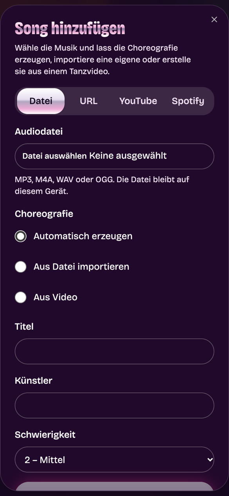

# DanceBeat

[](https://github.com/Simons-Github/dancebeat/actions/workflows/ci.yml) [](LICENSE.md)

A dance game for one player that runs entirely in the browser. You put your phone down, step back and dance along. The front camera tracks your pose and the game scores every move in real time.

**Live demo:** [dancebeat.berger-labs.com](https://dancebeat.berger-labs.com). No account needed. The interface is in German or English; switch the language in the settings.

<picture>
  <source media="(prefers-color-scheme: dark)" srcset="docs/screenshots/hero-dark.png">
  
</picture>

## Features

- Four demo songs, or your own music from a file, a URL, YouTube or Spotify
- Choreographies generated from motion-capture clips (AIST++), imported from JSON or extracted from a dance video on the device
- Pictogram bar and coach figure, combos, Gold Moves and a star rating with highscores
- Setup check for framing, light and full body before each song
- Motion mode without the camera: hold the phone and the motion sensor measures your movement on the beat
- Choreography editor, latency calibration, installable and playable offline
- Interface in German or English

<p>
  
  
  
</p>

## Tech stack

| | |
| --- | --- |
| UI | React 19, TypeScript (strict), TanStack Router and Query, Tailwind CSS 4, shadcn/ui |
| Pose detection | MediaPipe Pose Landmarker, models hosted with the app |
| Storage | IndexedDB, validated with zod |
| Offline | Custom service worker built by a Vite plugin |
| Tooling | Bun, Vite, Vitest, Testing Library, GitHub Actions, Vercel |

## How it works

```
Screens (src/routes, src/components)
   |
Hooks (usePoseTracking, useAudioClock, useScoring, useSongLibrary)
   |
Logic (src/lib: pose, scoring, choreo, audio, library, schema)
   |
Browser APIs (camera, MediaPipe WASM, audio, IndexedDB, service worker)
```

The game logic is plain TypeScript in `src/lib/` and can be tested without React. A few things were important to get right:

- **The audio is the clock.** Each audio source (file, URL, YouTube, Spotify) implements `getTimeMs()`, and the game only reads that, never `Date.now()`. Scoring stays in sync with what you hear, also after pausing or seeking.
- **Pose detection runs outside React.** MediaPipe is driven from a video frame callback and refs, and the skeleton and coach are drawn on a canvas. That avoids a React re-render for every camera frame.
- **Scoring ignores what the camera can't see.** Each move is compared by joint angles within a 250 ms window (`src/lib/scorer.ts`). Joints the camera can't see well are skipped instead of counted as wrong.
- **Nothing leaves the device.** The song library lives in IndexedDB and the Content Security Policy also blocks MediaPipe's built-in telemetry. The downside is that there is no sync between devices.

More technical detail (in German): [architecture](docs/architecture.md), [scoring](docs/scoring.md), [choreography format](docs/choreography-format.md).

## Running locally

```sh
bun install
bun run dev        # http://localhost:5173
bun run test
```

The first run downloads the MediaPipe models (about 15 MB). No `.env` is needed. To test on a phone, run `bun run dev:https` and open the LAN address. All scripts and troubleshooting are in [docs/development.md](docs/development.md).

## Tests

Vitest with Testing Library, jsdom and fake-indexeddb covers scoring, the choreography generator, the song library, data migrations and the main screens. CI runs the type check, lint, tests and build on every push.

## Limitations

- So far tested with unit tests and a headless browser with a fake camera. Real devices, especially iOS Safari, still need more testing.
- Spotify needs Premium and your own client ID, and always plays at normal speed.
- Video import assumes the video and the music start at the same time.
- Only the four demo songs are in the repo. Other audio and video files are not committed.

## License

[PolyForm Noncommercial 1.0.0](LICENSE.md). The license is non-commercial on purpose, because the AIST dance data may only be used non-commercially.

Credits: AIST++ motion data (Google, CC BY 4.0), choreographies from the AIST Dance Video Database (non-commercial use), MediaPipe and its models (Apache 2.0), Bricolage Grotesque (SIL OFL 1.1). The app lists all third-party content under Settings.
